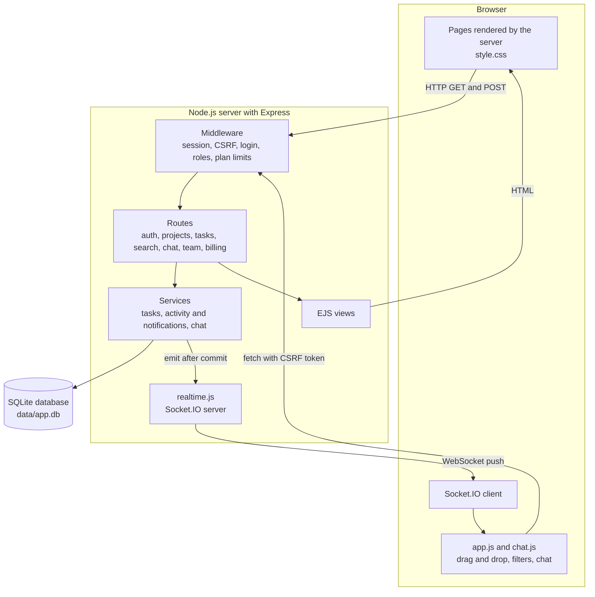
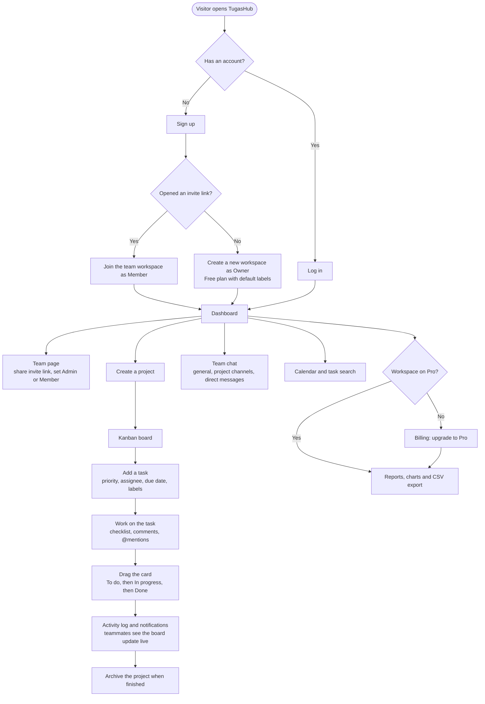
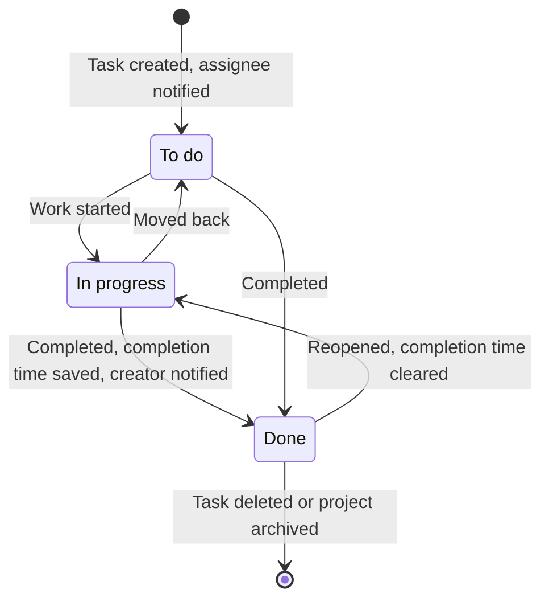
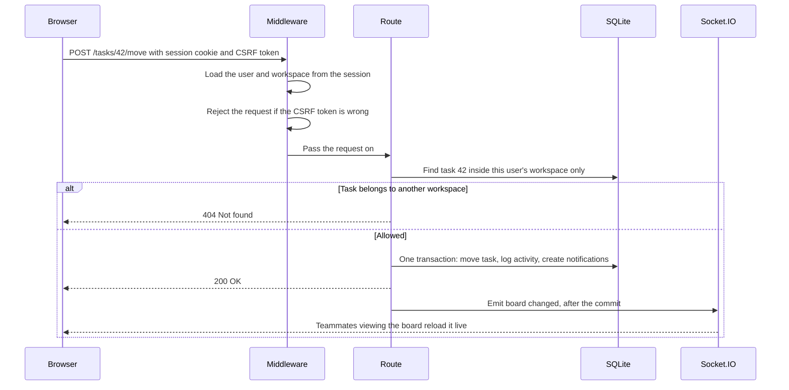
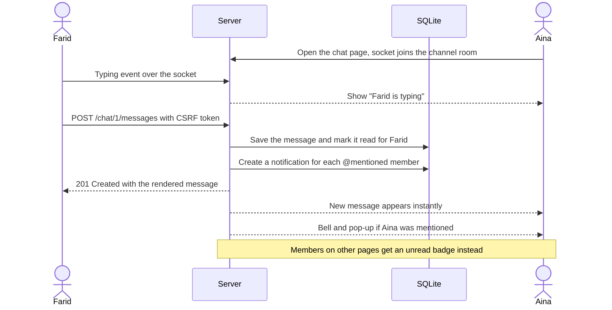
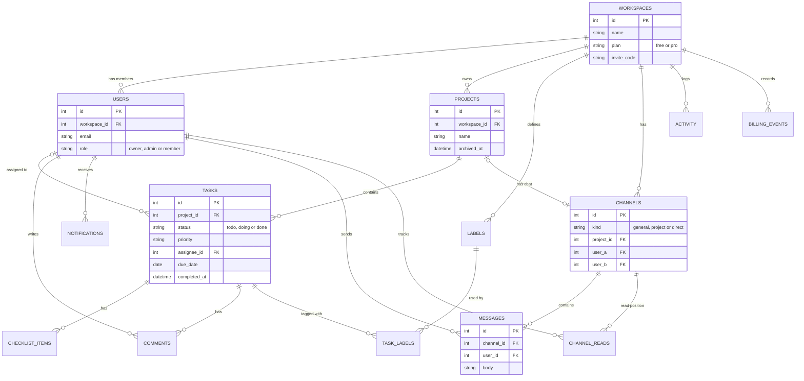

# TugasHub

A multi-tenant task and project management SaaS, built from scratch with **Node.js, Express, EJS and SQLite**.

Teams sign up, get their own workspace, invite members with a link, and run projects on kanban boards. They can discuss work in comments with @mentions, track progress on a calendar and in reports, and control who can do what with roles. Workspaces are on a **Free** plan or a **Pro** plan (RM29/month, simulated checkout) that unlocks reports, CSV export and unlimited usage.

## Features

### Work management
| Feature | What it does |
|---|---|
| Kanban boards | To do / In progress / Done columns with drag and drop, saved instantly. |
| Tasks | Title, description, priority, assignee, due date, labels. Overdue tasks are flagged. |
| Checklists | Break a task into steps; the card shows progress like `2/5`. |
| Labels | Workspace-wide colour labels such as Bug or Design, managed by admins. |
| Board filters | Filter a board by text, assignee, label, priority or due date. |
| Search | One page to search every task, with filters, sorting and pagination. |
| Calendar | Month view of due dates, coloured by project, with an "only mine" toggle. |
| Archiving | Archive finished projects to hide them without deleting anything. |

### Collaboration
| Feature | What it does |
|---|---|
| Comments | Discuss work on the task page. |
| @mentions | Type `@firstname`; the person is highlighted and notified. |
| Notifications | Bell with unread count. You hear about assignments, mentions, comments on your tasks, and completions. |
| Activity log | Every change is recorded: per task, per project, and workspace-wide with day grouping. |
| Team chat | Real-time chat (Socket.IO): #general, one channel per project, and private direct messages. Typing indicator, online status, unread badges, @mentions. |
| Live board | When a teammate changes a board, everyone viewing it sees the update instantly. |

### Analytics and admin
| Feature | What it does |
|---|---|
| Dashboard | Open, in-progress, due-this-week and overdue counts, project progress, your tasks and recent activity. |
| Reports (Pro) | Completion rate, week-on-week change, average days to finish, tasks completed per week, workload per member, open work by priority, project health. Every chart has a table view. |
| CSV export (Pro) | Download any filtered task list. Cells are escaped so spreadsheets cannot run them as formulas. |
| Roles | Owner, Admin and Member, enforced on the server. See the table on the Team page. |
| Billing | Free and Pro plans, usage bars, upgrade / downgrade, billing history. |

### Engineering
- **Multi-tenancy:** every query is scoped to the user's workspace.
- **Security:** bcrypt passwords, CSRF tokens on every form and API call, signed HTTP-only cookies, HTML-escaped user content, CSV formula-injection protection.
- **Database migrations:** versioned with `PRAGMA user_version`, so existing databases upgrade automatically and safely.
- **Real-time:** Socket.IO pushes chat messages, presence, notifications and board changes. Sockets only receive; every change still goes through a checked HTTP route.
- **Automated tests:** 17 end-to-end tests that boot the real app on a throwaway database (`npm test`).
- **Accessible, responsive UI:** keyboard-usable controls, light and dark mode, works on phones, no JavaScript framework.

## How it works

### 1. System architecture

The browser talks to one Node.js server in two ways: normal HTTP requests for pages and changes, and a WebSocket that the server uses to push live updates. All data lives in a single SQLite file.



### 2. User workflow

How a team uses TugasHub from sign-up to finished work.



### 3. Task lifecycle

Every task moves through three columns. Moving it, by dragging the card or editing its status, updates the board for everyone and is written to the activity log.



### 4. What happens on every change

Example: a member drags a card to another column. Every change in the app follows the same checks.



### 5. Real-time chat

Messages are saved over HTTP, then pushed to everyone allowed to see them.



### 6. Database design



## Requirements

- Node.js **22.13 or newer** (uses the built-in `node:sqlite` module, so there is no database server to install).

## Run it

```bash
npm install
npm run seed     # optional: creates a demo workspace with 8 weeks of sample data
npm run dev      # starts on http://localhost:3000 and restarts on file changes
npm test         # runs the test suite
```

Use `npm start` instead of `npm run dev` to run without auto-restart. Set `PORT` to change the port.

### Demo accounts (created by `npm run seed`)

All use the password `password123`. The demo workspace is on the Pro plan.

| Email | Role |
|---|---|
| aina@demo.test | Owner |
| farid@demo.test | Admin |
| mei@demo.test | Member |
| daniel@demo.test | Member |

To reset all data back to the demo, run `npm run reset` (works while the server is running).

## Project structure

```
src/
  server.js              Starts the HTTP server
  app.js                 Express app: sessions, view helpers, route mounting
  db.js                  SQLite connection and versioned migrations
  plans.js               Free / Pro plan limits and features
  permissions.js         Owner / Admin / Member rules
  middleware.js          Auth, roles, plan gates, flash messages, CSRF
  icons.js               Inline SVG icons
  seed.js                Demo data
  services/
    tasks.js             Shared task search/filter engine, moving tasks between columns
    activity.js          Activity log, notifications, @mention parsing and rendering
  routes/
    auth.js              Sign up (incl. invite links), log in, log out
    projects.js          Dashboard, projects, boards, archiving
    tasks.js             Task page, edits, drag-and-drop API, checklist, comments
    views.js             Search, CSV export, calendar, reports
    feed.js              Notifications and activity log
    workspace.js         Team and roles, billing, settings, labels
views/                   EJS templates (partials/ holds the shell and shared pieces)
public/
  css/style.css          All styling, light and dark mode
  js/app.js              Drag and drop, filters, dialogs, mention chips, chart tooltips
test/app.test.js         End-to-end tests
data/                    SQLite database and session secret (created at runtime, git-ignored)
```

## Database schema

```
workspaces      (id, name, plan, invite_code, created_at)
users           (id, workspace_id, name, email, password_hash, role, created_at)
projects        (id, workspace_id, name, description, color, archived_at, created_at)
tasks           (id, project_id, title, description, status, priority, assignee_id,
                 created_by, due_date, position, completed_at, created_at)
labels          (id, workspace_id, name, color)
task_labels     (task_id, label_id)
checklist_items (id, task_id, text, done, position, created_at)
comments        (id, task_id, user_id, body, created_at)
activity        (id, workspace_id, user_id, project_id, task_id, action, summary, created_at)
notifications   (id, user_id, actor_id, task_id, kind, message, url, read_at, created_at)
billing_events  (id, workspace_id, action, plan, amount, created_at)
channels        (id, workspace_id, kind, name, project_id, user_a, user_b, created_at)
messages        (id, channel_id, user_id, body, created_at)
channel_reads   (user_id, channel_id, last_read_id)
```

Deleting a workspace, project or task cascades to its children. Removing a member leaves their tasks unassigned and keeps their comments and history.

## Notes and limits

- Payments are **simulated**: upgrading records a billing event but charges nothing. A real version would use a payment provider such as Stripe or Billplz.
- Invites work by link only, and notifications are in-app only. No emails are sent.
- Each user belongs to one workspace.
